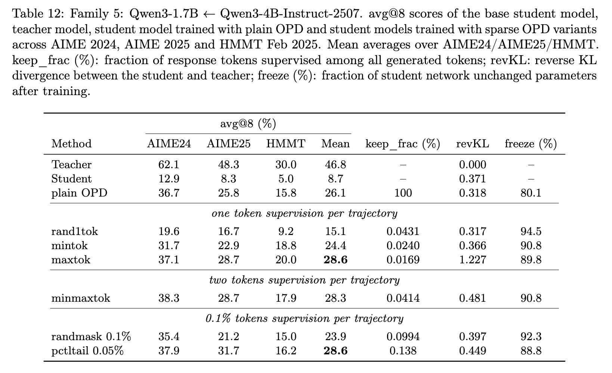
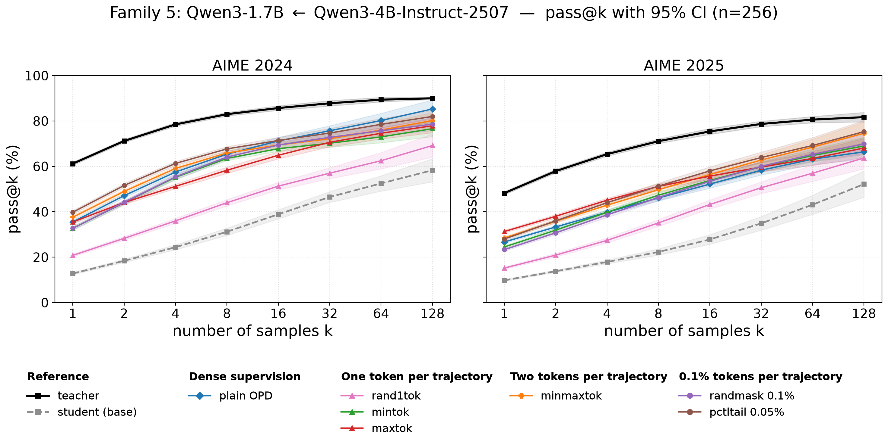

# Unofficial reproduction of SparseOPD

This repository reproduces [Extremely Sparse Supervision Incentivizes Reasoning Ability](https://arxiv.org/abs/2609.04565) with verl 0.8.0. The released setup focuses on **Family 5**: `Qwen3-1.7B` as the student and `Qwen3-4B-Instruct-2507` as the teacher, trained on DAPO-Math-17K.

Evaluation uses [Math-Verify](https://github.com/huggingface/Math-Verify) for mathematical answer parsing and equivalence checking; pass@k and avg@8 are computed from these binary correctness judgments.

## What we changed

- Added Sparse OPD token-selection modes to the on-policy distillation path: dense OPD, `rand1tok`, `maxtok`, `mintok`, `minmaxtok`, random masking, and reward-tail masking.
- Added the paper-style per-response token-mean loss aggregation and its distillation configuration.
- Added deterministic DAPO-Math-17K prompt deduplication with an audit manifest.
- Added checkpoint inference and Math-Verify evaluation for pass@k and avg@8.
- Added launchers and reusable YAML configuration for the Family 5 experiment suite.

## Conclusion

The current Family 5 reproduction results **do not** match the results reported in the paper. This reproduction effort has consumed a substantial amount of GPU time, but it has not yet produced paper-consistent numbers.

## avg@8 results

We reproduced the Family 5 student/teacher setting and ran the full listed math evaluation suite.

| Method | AIME24 | AIME25 | HMMT | Mean |
| --- | ---: | ---: | ---: | ---: |
| Teacher | 53.33 | 41.67 | 29.17 | 41.39 |
| Student | 11.25 | 8.75 | 5.42 | 8.47 |
| plain OPD | 25.00 | 18.75 | 11.67 | 18.47 |
| rand1tok | 14.58 | 11.67 | 4.17 | 10.14 |
| mintok | 15.00 | 10.00 | 6.67 | 10.56 |
| maxtok | 15.83 | 10.00 | 5.00 | 10.28 |
| minmaxtok | 17.08 | 13.33 | 10.00 | 13.47 |
| randmask 0.1% | 11.25 | 11.67 | 6.25 | 9.72 |
| pctltail 0.05% | 14.58 | 15.00 | 6.67 | 12.08 |

*Family 5 avg@8 reference table. Source: [paper Table 12](https://arxiv.org/html/2609.04565v1#A1.T12).*

## pass@k results

These runs use 256 samples per prompt and report pass@k on AIME 2024 and AIME 2025.

### AIME 2024

| Run | pass@1 | pass@2 | pass@4 | pass@8 | pass@16 | pass@32 | pass@64 | pass@128 |
| --- | ---: | ---: | ---: | ---: | ---: | ---: | ---: | ---: |
| Teacher | 53.42 | 61.33 | 66.99 | 72.39 | 78.03 | 83.35 | 87.79 | 91.10 |
| Student | 12.80 | 18.64 | 25.08 | 31.92 | 39.54 | 47.47 | 54.53 | 60.69 |
| plain OPD | 23.98 | 32.55 | 40.79 | 48.14 | 54.14 | 59.28 | 64.43 | 69.97 |
| rand1tok | 13.16 | 19.19 | 25.69 | 32.34 | 39.55 | 46.96 | 53.96 | 59.91 |
| mintok | 15.91 | 22.40 | 28.81 | 35.26 | 42.15 | 49.00 | 55.27 | 60.40 |
| maxtok | 15.00 | 21.65 | 28.65 | 35.76 | 43.36 | 50.77 | 56.48 | 59.90 |
| minmaxtok | 16.68 | 23.41 | 30.11 | 37.13 | 44.75 | 51.99 | 58.36 | 64.39 |
| randmask 0.1% | 13.07 | 18.72 | 24.65 | 30.74 | 37.74 | 45.17 | 51.38 | 56.99 |
| pctltail 0.05% | 16.25 | 23.03 | 29.70 | 36.40 | 43.44 | 50.18 | 56.61 | 63.56 |

### AIME 2025

| Run | pass@1 | pass@2 | pass@4 | pass@8 | pass@16 | pass@32 | pass@64 | pass@128 |
| --- | ---: | ---: | ---: | ---: | ---: | ---: | ---: | ---: |
| Teacher | 43.84 | 52.43 | 59.72 | 65.78 | 70.91 | 74.79 | 77.06 | 78.32 |
| Student | 10.08 | 14.37 | 18.65 | 22.94 | 27.80 | 33.39 | 38.85 | 43.94 |
| plain OPD | 17.23 | 22.57 | 28.56 | 35.55 | 42.67 | 48.82 | 53.90 | 58.76 |
| rand1tok | 10.83 | 15.48 | 20.03 | 24.62 | 29.83 | 35.82 | 42.08 | 48.66 |
| mintok | 12.06 | 16.93 | 21.78 | 26.89 | 32.72 | 39.02 | 44.73 | 49.04 |
| maxtok | 11.46 | 16.32 | 21.44 | 27.01 | 33.42 | 40.55 | 47.21 | 52.71 |
| minmaxtok | 12.43 | 17.23 | 22.08 | 27.01 | 32.07 | 37.09 | 42.22 | 48.55 |
| randmask 0.1% | 10.29 | 14.85 | 19.64 | 24.56 | 30.20 | 36.77 | 43.42 | 50.01 |
| pctltail 0.05% | 12.24 | 16.77 | 21.34 | 26.37 | 32.26 | 38.99 | 45.89 | 52.44 |

*Family 5 pass@k reference curves with 95% confidence intervals. Source: [paper Figure 13](https://arxiv.org/html/2609.04565v1#A1.F13).*
